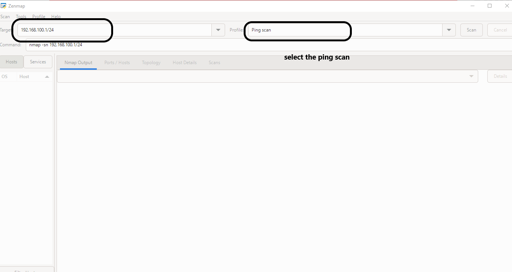

# Zenmap Installation Guide

## What is Zenmap?

Zenmap is the graphical user interface (GUI) for Nmap. It helps users perform network discovery and visualize scan results.

## Download

Official Nmap website:

https://nmap.org/download.html

## Installation Steps

1. Visit the official Nmap download page.
2. Select the Windows installer.
3. Download the installer.
4. Run the downloaded setup file.
5. Follow the installation instructions.
6. Launch Zenmap after installation.

## Verification

Open Zenmap and confirm that the application launches successfully.

## Operating System

Windows

## Evidence

